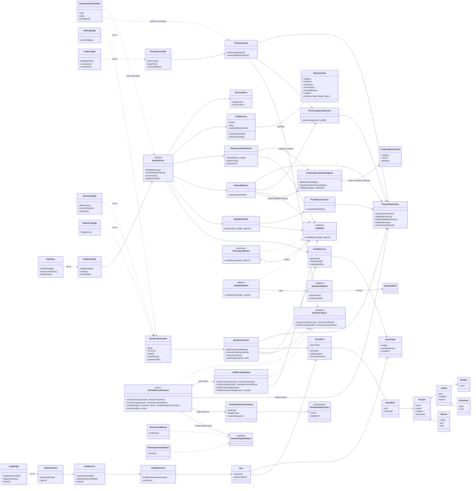
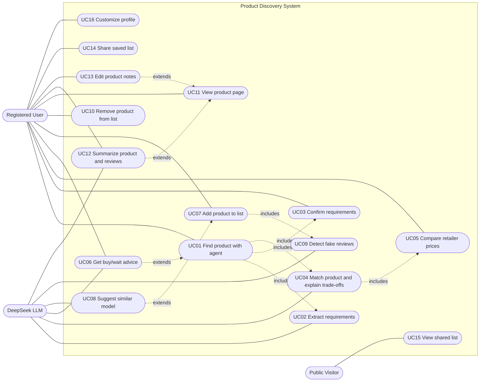
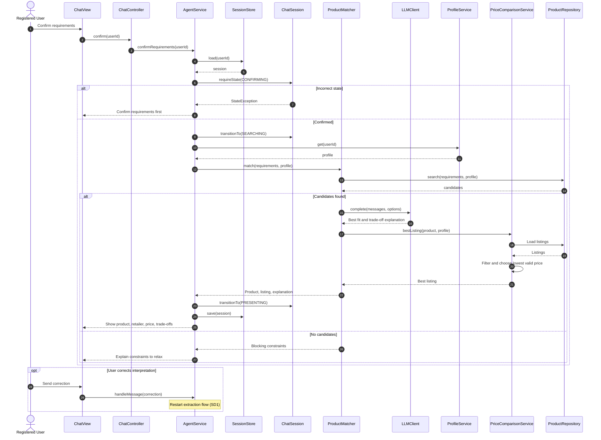
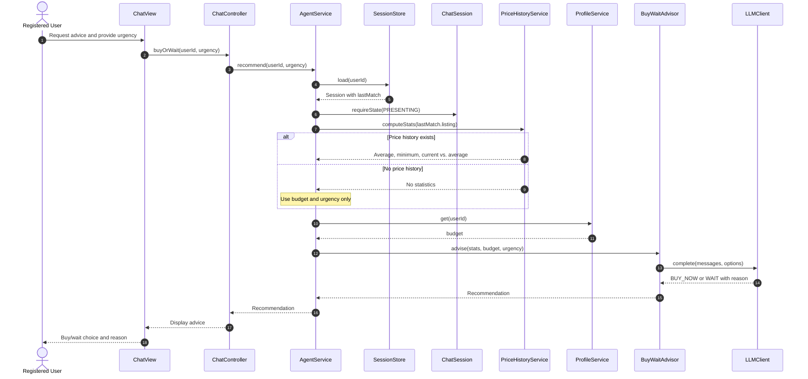
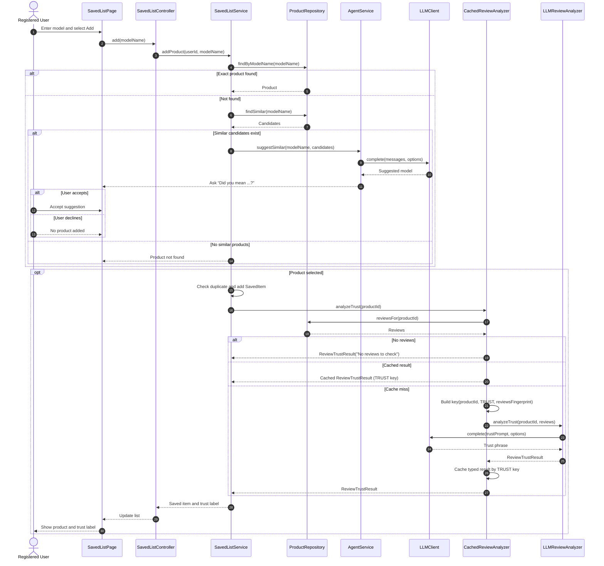
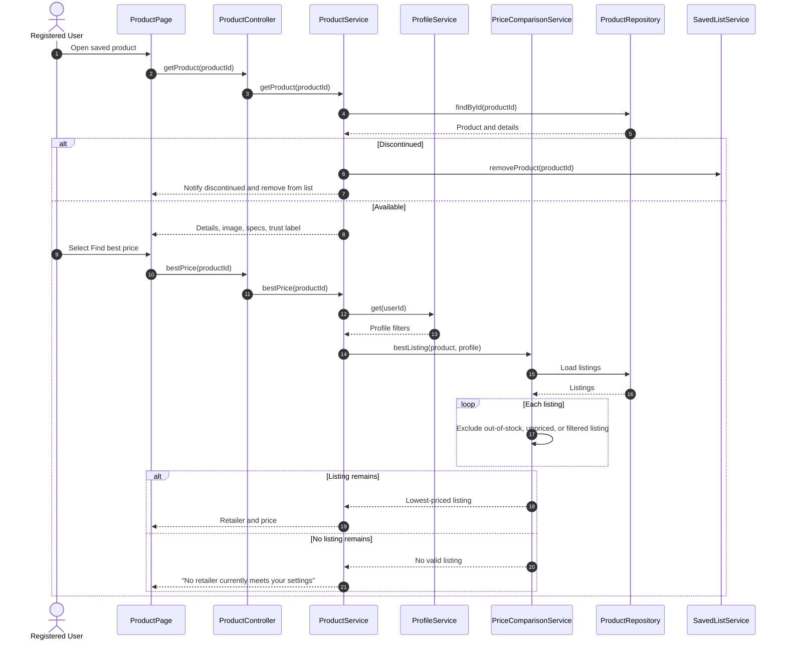
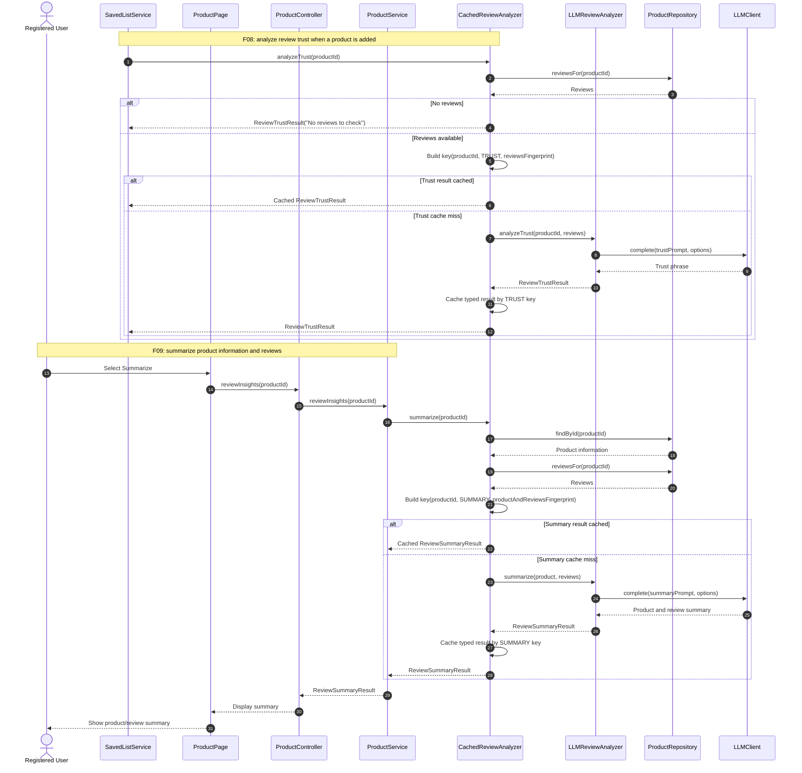
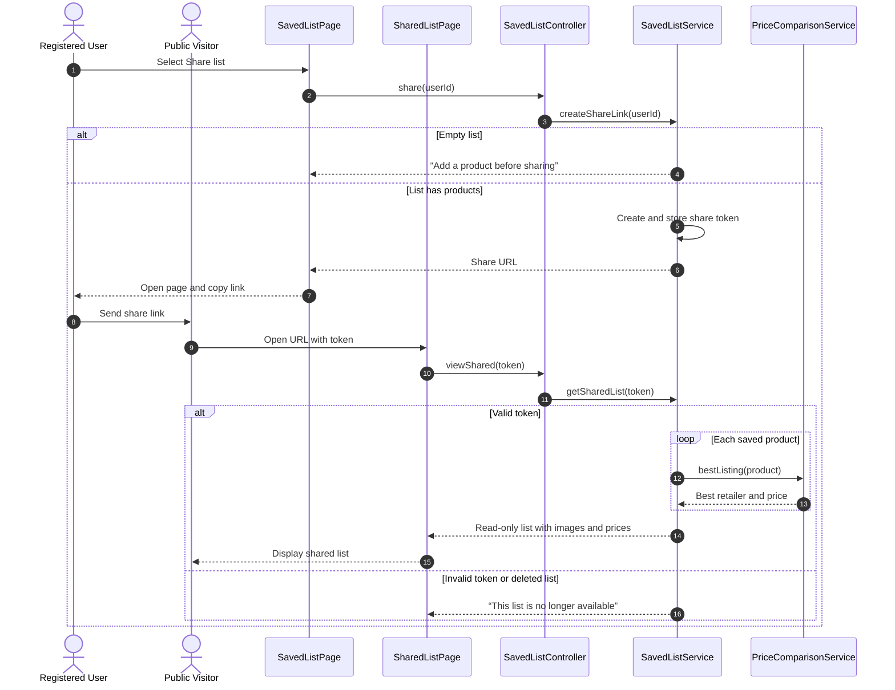
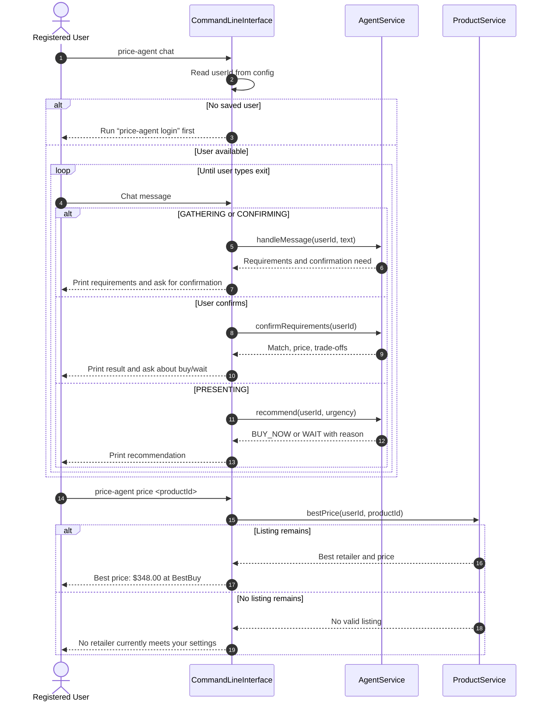

# Stage 1 Project Design Report

## Task 1: Define Your Agent Project

### 1.1 Project Description

What problem does your project solve?

   - This project will help users find products and the best prices for a specific product among different retailers. (* IMPORTANT NOTE: DB data of product info is generated/synthetic otherwise my software has to fight against anti-bot defense systems for data scraping off real websites which is unpredictable and is not the point of this project, and that external APIs for retailers are not easily accessible e.g. requiring payment)

- Who are the target users?

- Users that have at least some familiarity with using web apps or mobile apps which usually ranges from students to middle-aged adults.

- What can the agent do?

The agent will be designed to utilize behaviors necessary to fulfill the features ranging from decision making, retrieval, and more. An example could involve the agent being able to have autonomy in being able to extract requirements from natural language and compare that against DB data with decision making, to find a matching product.

Why is an AI agent appropriate for this problem?

An AI Agent is appropriate for this problem because it can perform tasks better than traditional software by non-deterministically deciding the best path to take on its own. It can also perform actions that traditional software cannot do such as trying a different approach if an attempt fails whereas traditional software will end by throwing an error.

Which AI/LLM model(s) do you plan to use?

DeepSeek models

How will the AI model interact with the rest of the software system?

- The user will input data through the frontend and the backend will process that data and call upon the AI model to satisfy requests. The backend will process the AI modelʼs responses and communicate it back to the frontend for the user to interact with.

### 1.2 Feature Specification
#### F01 — Natural language requirements extraction
- Description

   - If the user has no product model in mind, they can give a general prompt to the AI Agent that will help break down the requirements into structured attributes.

- User Interaction — How does the user access or use this feature through the GUI?

Opening the AI agent chatbox and giving a prompt

- Input — What information does the feature require?

It requires a description of what the user wants, with constraints in natural language

- Output — What does it produce?

Structured requirements/attributes

The requirements use a category-specific requirements schema derived from the structured product-spec schema for the identified product category. The shared requirement fields are category, maximum price, must-haves, nice-to-haves, excluded brands, and condition. `Requirements` also contains an `attributes: Map<String, Object>` field for category-specific constraints (for example, `storageGb` for a smartphone). Validate this map against the selected category's product-spec schema before the extracted `Requirements` object is accepted or persisted. Schemas for common categories, including technology products and clothing, are maintained in the designated product-schema resources.

- AI Involvement — Is the feature deterministic, AI-based, or hybrid?

AI-based. The agent can handle interpreting natural requirements.

- Expected Workflow — What happens when the feature is executed?

   - The agent will analyze the natural requirements and break it down into concrete constraints against some structured schema for consistency

- Error/Alternative Cases — What could go wrong and how should the system respond?

The system could interpret requirements incorrectly. If the user sees misinterpretation then the AI could be notified and it could output itʼs current understanding of the situation, and allow the user to identify what the AI is missing in their understanding, until they get on the same page. The system can ask the user to verify the interpretation in some dialog pop up
#### F02 — Feature matching and trade off explanation
- Description

To find a product that matches the desired requirements, engaging in trade offs for the best fit

- User Interaction — How does the user access or use this feature through the GUI?

When a user tries to prompt for a product with their constraints, after verifying with agent that it has understood its requirements

- Input — What information does the feature require?

Product requirements, and confirmation of agent to search

- Output — What does it produce?

Best fit product based on requirements and trade off explanation

- AI Involvement — Is the feature deterministic, AI-based, or hybrid?

   - AI based

- Expected Workflow — What happens when the feature is executed?

Once structured requirements are extracted from user, the agent will use that to search through DB data to match the user requirements. Once a product is decided, then the agent can decide to use the price comparison tool to find the best price of that product, giving a trade off explanation

Error/Alternative Cases — What could go wrong and how should the system respond?

The trade off explanation could be not sound, allowing user to correct it and retry again, or simply retry if they wanted to
#### F03 — Price history based buy/wait recommendation
   - Description

The agent looks at price history data from DB, checks whether the current price is unusually high or low, factors in your budget and urgency, and recommends buying now or waiting.

User Interaction — How does the user access or use this feature through the GUI?

After a product and retailer combo has been found by the agent as a best fit, this feature can be prompted to the user to see if they want buy now or wait

Input — What information does the feature require?

Price history data from DB for the retailer of this product

Output — What does it produce?

Recommendation to buy now or wait, based on price history

- AI Involvement — Is the feature deterministic, AI-based, or hybrid?

   - Hybrid. Traditional software can compare against avg prices while the agent can factor budget, urgency, and the objective values for a final recommendation

- Expected Workflow — What happens when the feature is executed?

Agent looks at price history data from DB, uses traditional software to check if price is unusually high or low, uses its reasoning to factor in budget and urgency, and generates a recommendation statement

Error/Alternative Cases — What could go wrong and how should the system respond?

No avg price data. Then this step would not be taken into effect.
#### F04 — Product list management
   - Description

This maintains a list of products that youʼve saved to keep track of so that you can navigate into that product to do different actions e.g. see the retailer with the best price. Users can add and remove products from the list.

- User Interaction — How does the user access or use this feature through the GUI?

A list of products that you can select from, and it will direct you to a dedicated page for that product with more info about it such as the retailer with the best price

- Input — What information does the feature require?

Users have to enter a specific product (most likely a specific model) so that it can be added into the list and fetch relevant data for the product

- Output — What does it produce?

A list of saved products

- AI Involvement — Is the feature deterministic, AI-based, or hybrid?

Hybrid

- Expected Workflow — What happens when the feature is executed?

   - Traditional software will search for the product and confirm it exists. If so, then it will add it to the list. Agent can handle some error cases mentioned below.

- Error/Alternative Cases — What could go wrong and how should the system respond?

   - A product model is entered incorrectly. The agent would suggest a valid similar match and confirm with the user if they wanted that
#### F05 — Compare prices among retailers for a product
- Description

For a product, the user can click a button and retrieve the retailer with the best price currently.

User Interaction — How does the user access or use this feature through the GUI?

The user clicks a button on the saved productʼs dedicated page in the app.

- Input — What information does the feature require?

Prices from different retailers for the same model

- Output — What does it produce?

The retailer with the best price, and the corresponding price

- AI Involvement — Is the feature deterministic, AI-based, or hybrid?

   - Deterministic as the data from different retailers pulled from DB will be analyzed using deterministic software and return the retailer and best price

- Expected Workflow — What happens when the feature is executed?

Based on the chosen product, the software will search through DB data using deterministic software, comparing retailer prices, and then finally return the retailer with the best price currently.

- Error/Alternative Cases — What could go wrong and how should the system respond?

A product model no longer exists/discontinued. The system would notify user and delete it.
#### F06 — Share list to others
- Description

   - The saved list is appended to a standalone page, showing the product, image, and retailer + best price. This page can be publicly accessible by anyone as long as they have the link.

User Interaction — How does the user access or use this feature through the GUI?

Click on a button to get the shareable page generated

Input — What information does the feature require?

The current saved list details

Output — What does it produce?

Shows each product, image, and retailer + best price. This page can be publicly accessible by anyone as long as they have the link.

- AI Involvement — Is the feature deterministic, AI-based, or hybrid?

Deterministic as traditional software can easily convert the list into a separate publicly accessible page.

- Expected Workflow — What happens when the feature is executed?

   - Click button to generate shareable list. Opens a new page for the list and link is copied to clipboard. User can choose to send the link to someone.

Error/Alternative Cases — What could go wrong and how should the system respond?

A user could try to generate the shareable list on an empty product list. The system should respond by denying the user from executing the action because it is not a valid input.
#### F07 — User profile customization
   - Description

   - The user can modify their own core settings that are reusable across different searches instead of re-entering the same settings in searches. This can include budget constraints, excluding brands, product conditions

   - User Interaction — How does the user access or use this feature through the GUI?

They go to settings page and modify their settings to their liking

- Input — What information does the feature require?

User input such as budget amount, brands to exclude, conditions like New only, etc.

- Output — What does it produce?

Allows for the price comparison to give a more informed result that is tailored to the user

- AI Involvement — Is the feature deterministic, AI-based, or hybrid?

Deterministic as traditional software can handle modifying settings e.g. budget constraints easily and reliably.

- Expected Workflow — What happens when the feature is executed?

Settings will be modified and saved. In the future when a price comparison occurs, these will be taken into account.

- Error/Alternative Cases — What could go wrong and how should the system respond?

Invalid inputs for settings such as a non-existing brand name. The system should respond with feedback about the invalidity.
#### F08 — Fake Reviews Detector
   - Description

On the page of the saved product, there will be an indicator that will state the trustworthiness of the reviews for this product, e.g. “Suspicious Reviews”, so that the user can avoid buying deceptive products.

- User Interaction — How does the user access or use this feature through the GUI?

On the productʼs page in the app

- Input — What information does the feature require?

Pulling reviews from the selected retailers

- Output — What does it produce?

A summarized phrase indicator to show the trustworthiness of the product reviews

- AI Involvement — Is the feature deterministic, AI-based, or hybrid?

   - Hybrid. Traditional software can handle parts like pulling review data. AI can interpret the reviews and give a trustworthiness rating.

- Expected Workflow — What happens when the feature is executed?

When the product is added to the saved list, the review detection will execute and set the rating from there.

- Error/Alternative Cases — What could go wrong and how should the system respond?

There could be no reviews at all. The system should give UI feedback with no review checking present
#### F09 — Summarization of product info and reviews
Product info and reviews will be fetched, summarized, and appended to the product for the user to make better informed decisions

- User Interaction — How does the user access or use this feature through the GUI?

Clicking a button on the productʼs dedicated page will show the summary

- Input — What information does the feature require?

Product descriptions, and reviews

- Output — What does it produce?

   - A summary of the product info and reviews

- AI Involvement — Is the feature deterministic, AI-based, or hybrid?

   - Hybrid. Traditional software can pull data from the DB and AI will process that data into a summary

- Expected Workflow — What happens when the feature is executed?

When the user clicks the summarize button, the relevant data will be pulled from DB for that product and AI will be called to summarize the info and then display the summary

- Error/Alternative Cases — What could go wrong and how should the system respond?

Missing price in the scraped data. The system should respond by eliminating that retailer off the choices to analyze.
#### F10 — User notes for a saved product
   - Description

User can write their own notes for a product in their saved list that they want to be reminded of

- User Interaction — How does the user access or use this feature through the GUI?

Clicking a button on the product in their list will show the notes

- Input — What information does the feature require?

User input of notes

- Output — What does it produce?

Display their currently saved notes

- AI Involvement — Is the feature deterministic, AI-based, or hybrid?

Deterministic, traditional software can easily read and write to saved notes content

- Expected Workflow — What happens when the feature is executed?

User clicks the saved notes button, they can read the displayed notes, type into it, and save it.

- Error/Alternative Cases — What could go wrong and how should the system respond?

   - Unidentifiable characters pasted could potentially cause errors

## Task 2: Design Your System Using UML

### Implementation decisions

- **Application:** Java 21 backend using Spring Boot 4.1.2, exposing an API to a React frontend. The React application supplies the chat, product, saved-list, and settings views. The Java CLI can use the same application services. Spring Boot 4.1.2 is selected as the stable 4.1 release rather than a 4.2 release candidate; set the Java compiler release to 21. See the [Spring Boot 4.1.2 release](https://github.com/spring-projects/spring-boot/releases/tag/v4.1.2) and its [published parent POM](https://repo.maven.apache.org/maven2/org/springframework/boot/spring-boot-starter-parent/4.1.2/spring-boot-starter-parent-4.1.2.pom), which sets Java 17 as its baseline.
- **Authentication:** Provide simple registration, login, and logout, with users stored in PostgreSQL. Store unique usernames and password hashes; never store plaintext passwords. Use session-based authentication for the local React/API application. Authentication protects registered-user operations, while shared-list viewing remains public.
- **Database:** Use a local PostgreSQL database and synthetic product/catalog data. The project has no deployment target.
- **Product-spec schemas:** Keep versioned JSON Schemas in a designated `product-schemas/` resource directory. The initial schemas cover smartphones, laptops, tablets, televisions, headphones, and clothing (tops, bottoms, and footwear). Each schema specifies typed attributes, canonical units, validation rules, and which attributes are required or optional. The catalog and agent use the schema for the selected product category.
- **Product ranking:** Apply deterministic eligibility checks for explicit requirements and profile filters first. The agent then non-deterministically ranks and tie-breaks eligible candidates using their category's structured schema. Do not prescribe a fixed weighted scoring or tie-breaking formula.
- **Review analysis:** The agent chooses a concise, non-deterministic trust phrase based on the reviews (for example, “Trustworthy Reviews” or “Highly Suspicious Reviews”); the design does not impose a numeric score or fixed label rubric. Review trust results and product/review summaries have distinct result types. Cache keys include the analysis type and a fingerprint of all inputs used for that analysis, so different analyses cannot collide and changed inputs invalidate cached results.

#### Initial product-spec schema coverage

Every product has common identity and listing data, including its category, brand/model, condition, and retailer offers. Category schemas define the typed, category-specific attributes that can be used to express requirements and compare eligible candidates.

| Category | Initial category-specific attributes |
|---|---|
| Smartphone | Display size and resolution, operating system, memory, storage capacity, battery capacity, connectivity |
| Laptop | Display size and resolution, processor, memory, storage type and capacity, graphics, operating system |
| Tablet | Display size and resolution, operating system, memory, storage capacity, connectivity, stylus support |
| Television | Screen size, resolution, panel type, refresh rate, HDR support, smart-TV platform |
| Headphones | Form factor, wired/wireless connectivity, noise cancellation, battery life, supported connection types |
| Clothing tops | Garment type, size and size system, fit, material, color, sleeve style |
| Clothing bottoms | Garment type, size and size system, waist, inseam, fit, material, color |
| Footwear | Shoe type, size and size system, width, material, closure, intended use |

Use explicit units for measurable values and preserve sizing systems for apparel and footwear rather than treating sizes as interchangeable. The product-spec schema describes product attributes; the agent's structured requirements use a category-specific requirements schema derived from those attributes and the shared requirement fields (category, maximum price, must-haves, nice-to-haves, excluded brands, and condition). The `Requirements` object carries category-specific constraints in `attributes: Map<String, Object>`; validate that map against the selected category's product-spec schema before accepting or persisting extracted requirements.

### 2.1 Class Diagram


Singleton pattern

What design problem does the pattern address?

Prevent duplicate clients for each feature, which would otherwise duplicate HTTP connections to Deepseek.

Which classes participate in the pattern?

- SharedLLMClient

Feature classes like ProductMatcher or RequirementsExtractor

What role does each class play?

The SharedLLMClient will be a single instance with a global access point to it for features to talk to the LLM. It owns attributes like the API key, URL, and HTTP connection.

Why is this pattern appropriate?

Instead of redundant API key code, URL, model name, and more every time you use a feature that talks to the LLM model, you reuse the same connection instance.

What would be more difficult if the pattern were not used?

Features would re-create many clients and connections which could exceed the limits given by Deepseek.

Proxy

- What design problem does the pattern address?

It avoids recomputing either review-trust analysis or product/review summaries when their relevant inputs have not changed. The proxy controls access to the real analyzer and keeps the two cached analysis types separate.

- Which classes participate in the pattern? What role does each class play?

ReviewAnalyzer (interface)

Declares typed operations for analyzing review trust and summarizing product/review information. Trust analysis returns `ReviewTrustResult`; summarization returns `ReviewSummaryResult`.

CachedReviewAnalyzer (proxy)

Builds a cache key from the product ID, analysis type, and a fingerprint of the analysis inputs. On a hit it returns the correctly typed stored result without involving the LLM. On a miss it calls the real analyzer and caches its result. Trust-analysis and summary entries cannot collide; summary fingerprints include product information as well as reviews.

LLMReviewAnalyzer (real analyzer)

Builds a task-specific prompt and returns the corresponding typed trust-analysis or summary result on a cache miss.

LLMClient (used by the real analyzer, which is not part of the proxy)

The interface LLMReviewAnalyzer uses to talk to DeepSeek (with SharedLLMClient) for trust phrases and summaries

- Why is this pattern appropriate? What would be more difficult if the pattern were not used?

   - The proxy class acts as a substitute for the real class to improve performance before engaging in unnecessary LLM calls by giving cached results.

#### Facade

What design problem does the pattern address? What would be more difficult if the pattern were not used?

Addresses a tight coupling issue of code. One AI action will require many classes like the LLM client, or prompt building, and the controller methods in the API would depend on these classes, causing them to be repeated for every controller method/route for the API.

Which classes participate in the pattern? What role does each class play?

- The client is ChatController

Only concerned with HTTP. It processes the request, calls a facade method and returns a result.

the facade is AgentService

It coordinates the inner classes to do the actual work, by delegation

and the inner classes could be

- RequirementsExtractor

Creates the prompt, calls the LLM to extract requirements

- ProductMatcher

When the user confirms their requirements, the class searches the DB and returns the best fitting product with the best retailer price and a trade off explanation.

- SessionStore

Loads and saves a user's chat session so the conversation and its current state stays the same between requests.

- ChatSession

Holds the conversation history, the pending requirements, and the current state (could be GATHERING, CONFIRMING, SEARCHING, PRESENTING). A requireState method check blocks a search before the user confirms

- BuyWaitAdvisor

Takes the precomputed price data, user's budget, urgency, makes a LLM call and returns the buy or wait recommendation

- Why is this pattern appropriate?

The facade allows for a single entry point of rules like the agent confirming requirements before making a search, and centralized logic so that it is not repeated within the controller methods, helping with decoupling.

#### Adapter

What design problem does the pattern address?

DeepSeek's API uses its own JSON structure which doesnʼt match the types my app works with. Without some translation layer, every class that calls the model would have to process format itself.

Which classes participate in the pattern?

LLMClient, DeepSeekClient (Adapter) and the DeepSeek API. The client classes are ProductMatcher, RequirementsExtractor, BuyWaitAdvisor, and LLMReviewAnalyzer.

What role does each class play?

LLMClient defines the interface in our own types and DeepSeekClient implements it by converting those types to DeepSeek's JSON format, sending the request, converting the response back. The client classes call only LLMClient

Why is this pattern appropriate?

Many features need the model so keeping DeepSeek's format in one class keeps the code maintainable.

What would be more difficult if the pattern were not used?

If something changed on DeepSeek's end like their API, it would lead to changes in every class that calls the model.

Decorator

- What design problem does the pattern address?

A LLM call can lead to some out of control temporary DeepSeek failures but putting retry code inside DeepSeekClient would mix translating DeepSeek's API with retry code all in one class. The decorator adds retry code around the client without changing it.

- Which classes participate in the pattern?

LLMClient, DeepSeekClient and RetryingLLMClient (Decorator). The client classes are ProductMatcher, RequirementsExtractor, BuyWaitAdvisor, and LLMReviewAnalyzer.

- What role does each class play?

LLMClient is the interface and DeepSeekClient does the call to DeepSeek. RetryingLLMClient implements LLMClient and contains another LLMClient, retrying the call if DeepSeek returns some temporary failures

- Why is this pattern appropriate?

Retrying is essential, otherwise one temporary failure would break features like the whole product search feature

- What would be more difficult if the pattern were not used?

   - Retry code could be crammed into DeepSeekClient mixing unrelated responsibilities or duplicated in every feature class that calls the model.

### 2.2 Use Case Diagram


#### Relevant Actors

Registered User: Searches with the agent, manages the saved list, views products, shares the list and edits settings

Public Visitor: Anyone with a share link. Can only view a shared list and needs no account.

Deepseek LLM: Actor for every AI and hybrid use case. Through the DeepSeek API.

#### UC01

**Use Case Name:**
 Find product with agent

**Actor(s):**
 Registered User (primary), DeepSeek LLM

**Goal:**
 Find the product that best fits the user's needs, at the best retailer price, without knowing a specific model

**Preconditions:**

The user is signed in

**Trigger:**

The user opens the agent chat box and sends a message describing what they want.

**Main Success Scenario:**

The user describes the product and constraints in natural language.

   - The system extracts structured requirements (related to UC02)

   - The system shows its interpretation and the user confirms it (related to UC03)

   - The system searches the database and selects the best-fit product with a trade off explanation (related to UC04) The system displays the product, its best retailer and price, and the trade off explanation.

**Alternative/Exception Flows:**

The user says the interpretation is wrong, the conversation returns to the first step with the user's correction.

No product matches the requirements, the agent explains which constraint ruled products out and asks the user to relax that.

The user rejects the trade off explanation, the user corrects it or asks to retry, and the system repeats the 4th step in the success scenario

DeepSeek returns a temporary error, the system retries the call automatically.

**Postconditions:**

A recommended product and retailer are shown.

The chat session is in the PRESENTING state.

- Related Feature(s)

F01, F02
#### UC02
**Use Case Name:**
 Extract requirements

**Actor(s):**

DeepSeek LLM

**Goal:**

Turn the user's natural language request into structured requirements via category, max price, must haves, nice to haves, excluded brands and condition.

**Preconditions:**

A chat session exists in the GATHERING state.

**Trigger:**

Related to UC01 when the user sends a message with their needs

**Main Success Scenario:**

The system loads the chat history and the user's profile settings (related to UC16).

The system builds a prompt and sends it to DeepSeek.

The system provides the category's structured product-spec schema and derived requirements schema in the prompt. DeepSeek returns requirements as JSON conforming to the requirements schema, including an `attributes` object for category-specific constraints. The system validates those attributes against the selected category's product-spec schema before converting the response to `Requirements` and saving it as pending.

The validated JSON is converted into a `Requirements` object and stored as pending in the session.

The session moves to CONFIRMING.

**Alternative/Exception Flows:**

The request is vague e.g. no category, the agent asks the user a follow up question and the session stays in GATHERING. DeepSeek returns a temporary error, the system retries the call automatically

**Postconditions:**

Pending requirements are saved in the chat session.

- Related Features

F01
#### UC03
**Use Case Name:**
 Confirm requirements

**Actor(s):**

Registered User, DeepSeek LLM

**Goal:**

Make sure the agent and the user agree on the requirements before any search runs

**Preconditions:**

The session is in the CONFIRMING state with pending requirements.

**Trigger:**

Included by UC01 after UC02 finishes

**Main Success Scenario:**

The system shows the pending requirements in a confirmation dialog. Category-specific attributes are displayed as readable labels and values, with units where applicable, rather than serialized JSON.

The user confirms.

The session moves to SEARCHING.

**Alternative/Exception Flows:**

The user points out the agentʼs misunderstanding, the agent states its current understanding, the user says what is missing, and UC02 runs again with the correction.

The user cancels, the session returns to GATHERING.

**Postconditions:**

The requirements are confirmed and the search is allowed to run. Related Features F01

#### UC04

**Use Case Name:**
 Match product and explain trade-offs

**Actor(s):**
 DeepSeek LLM
**Goal:**

Pick the best fitting product for the confirmed requirements and give an explanation of the trade offs.

**Preconditions:**

The session is in the SEARCHING state with confirmed requirements.

**Trigger:**

Included by UC01 after the user confirms (UC03)

**Main Success Scenario:**

The system searches the DB for potential products using the requirements and profile filters.

The system sends eligible candidates, requirements, and the applicable category schema to DeepSeek.

DeepSeek non-deterministically ranks schema-described candidates and returns the best fit with a trade-off explanation. No fixed weighting or tie-breaking formula is imposed. The system finds the best retailer price for that product (includes UC05).

The session changes to PRESENTING.

**Alternative/Exception Flows:**

No candidates are found, the agent returns which constraints were too strict.

DeepSeek returns a temporary error, the system retries the call automatically.

**Postconditions:**

The best fit product, its best listing and a trade-off explanation

   - Related Features
- F02
#### UC05

**Use Case Name:**
 Compare retailer prices
**Actor(s):**
 Registered User
**Goal:**

Show which retailer currently has the lowest price for a product.

**Preconditions:**

The product must exist in the database.

**Trigger:**

The user clicks "Find best price" on a product's page, or UC04 includes it.

**Main Success Scenario:**

The system loads all listings for the product.

The system removes listings that are out of stock, have no price, or fail the user's profile filters (e.g. brand, condition).

The system selects the listing with the lowest price.

The system shows the retailer and the price.

**Alternative/Exception Flows:**

The product is discontinued, the system tells the user and removes it from their saved list.

No listings remain after filtering, the system shows "No retailer currently meets your settings"
**Postconditions:**
 The best retailer and price are shown.

Related Features F05
#### UC06
**Use Case Name:**

Get buy / wait advice

**Actor(s):**

Registered User (primary), DeepSeek LLM

**Goal:**

Tell the user whether to buy now or wait, based on price history, budget and urgency.

**Preconditions:**

UC01 has produced a product and retailer (chat session is in state PRESENTING).

**Trigger:**

The user accepts the "Should I buy now or wait?" prompt shown after a product and retailer has been given by the system

**Main Success Scenario:**

The user selects how urgently they need the product.

The system computes price statistics (average, minimum, current versus average) from the listing's price history.

The system sends the statistics, the user's budget and urgency to DeepSeek.

DeepSeek returns a buy or wait recommendation with a reason.

The system displays the recommendation.

**Alternative/Exception Flows:**

No price history exists, the price history step is skipped and the recommendation uses only budget and urgency.

DeepSeek returns a temporary error, the system retries the call automatically.

**Postconditions:**

A buy or wait recommendation is shown to user.

- Related Features
- F03
#### UC07
**Use Case Name:**

Add product to list

**Actor(s):**

Registered User

**Goal:**

Save a specific product model to the user's list to track it.

**Preconditions:**

The user is signed in.

**Trigger:**

The user enters a product model name and clicks "Add".

**Main Success Scenario:**

The user enters a model name.

The system finds the product in the database.

The system adds the product to the user's saved list.

The system runs fake review detection for the product (includes UC09).

The productʼs page will now have and show a trust label.

**Alternative/Exception Flows:**

No product matches the name, the system suggests a similar model (extends with UC08).

The product is already in the list, the system tells the user and adds nothing.

**Postconditions:**

The product is in the user's saved list with a trust label.

- Related Features

F04, F08

#### UC08
**Use Case Name:**

Suggest similar model

**Actor(s):**

Registered User, DeepSeek LLM
**Goal:**

Handle a incorrectly typed or unknown model name.
**Preconditions:**
 UC07 could not find the entered model.
**Trigger:**
 Extends UC07 at step 2 when no exact match is found.
**Main Success Scenario:**
 The system retrieves products with similar names. The system asks DeepSeek which candidate the user most likely meant. The system asks the user something along the lines of “Did you mean…” The user accepts and UC07 continues from step 3 (i.e. adding the product)
**Alternative/Exception Flows:**
 No similar products exist, the system shows "Product not found". The user declines and nothing is added and the user can enter a different name.
**Postconditions:**
 The suggested product is added or the list is unchanged. Related Features F04
#### UC09
**Use Case Name:**
 Detect fake reviews
**Actor(s):**
 DeepSeek LLM
**Goal:**
 Rate how trustworthy a product's reviews are.
**Preconditions:**
 The product has been added to a saved list.
**Trigger:**
 Included by UC07 when a product is added.
**Main Success Scenario:**
 The system loads the product's reviews from all retailers. The system checks for a cached `ReviewTrustResult` using a key that includes the product ID, `TRUST` analysis type, and review-content fingerprint. On a cache miss, the system sends the reviews to DeepSeek for analysis. DeepSeek chooses a concise trust phrase, for example "Trustworthy Reviews" or "Highly Suspicious Reviews"; no fixed label rubric or numeric score is required. The system stores the phrase on the saved item and caches the typed result.
**Alternative/Exception Flows:**
 The product has no reviews, the label is set to "No reviews to check". A cached result is found, and it is used and DeepSeek is not called. DeepSeek returns a temporary error, the system retries the call automatically.
**Postconditions:**
 The saved item has a trust label shown on the product page. Related Features F08
#### UC10
**Use Case Name:**
 Remove product from list
**Actor(s):**
 Registered User
**Goal:**
 Stop tracking a product.
**Preconditions:**

The product is in the user's saved list.
**Trigger:**

The user clicks "Remove" on a saved product.

**Main Success Scenario:**
 The user clicks Remove

The system asks for confirmation. The user confirms.

The system deletes the saved item and its notes.
**Alternative/Exception Flows:**
 The user cancels, nothing changes.
**Postconditions:**
 The product is no longer in the list. Related Features F04
#### UC11
**Use Case Name:**
 View product page
**Actor(s):**
 Registered User
**Goal:**
 See the details of a saved product.
**Preconditions:**
 The product is in the user's saved list.
**Trigger:**
 The user selects a product in their saved list.
**Main Success Scenario:**
 The system loads the product details, image, specifications and trust label. The system displays the product page with actions for best price (UC05), summary (UC12) and notes (UC13).
**Alternative/Exception Flows:**

The product is discontinued and the system tells the user and removes it from the list.
**Postconditions:**
 The product page is displayed. Related Features F04, F05, F08
#### UC12
**Use Case Name:**
 Summarize product and reviews
**Actor(s):**
 Registered User, DeepSeek LLM
**Goal:**
 Give the user a short summary of the product information and its reviews.
**Preconditions:**
 The user is on a product page (UC11)
**Trigger:**
 The user clicks "Summarize" (extends UC11).
**Main Success Scenario:**

The system loads the product description and reviews.

The system checks for a cached `ReviewSummaryResult` using a key that includes the product ID, `SUMMARY` analysis type, and fingerprints of the product information and reviews.

On a cache miss, the system sends the data to DeepSeek.

DeepSeek returns a product and review summary.

The system displays and caches the summary.
**Alternative/Exception Flows:**

A retailer's data has no price, that retailer is left out of the analysis. A cached summary exists, it is shown without calling DeepSeek. DeepSeek returns a temporary error, the system retries the call automatically.
**Postconditions:**

A summary is displayed on the product page.

Related Features F09
#### UC13
**Use Case Name:**
 Edit product notes
**Actor(s):**
 Registered User
**Goal:**
 Keep personal reminders about a saved product.
**Preconditions:**
 The user is on a product page (UC11)
**Trigger:**
 The user clicks "Notes" (extends UC11).
**Main Success Scenario:**
 The system shows the current notes. The user edits the text and clicks "Save". The system saves the notes.
**Alternative/Exception Flows:**
 The text contains unsupported characters and the system removes them and tells the user what was changed before saving.
**Postconditions:**
 The notes are saved to the saved item. Related Features F10
#### UC14
**Use Case Name:**
 Share saved list
**Actor(s):**
 Registered User
**Goal:**
 Create a public link to the user's saved list.
**Preconditions:**
 The user is signed in.
**Trigger:**
 The user clicks "Share list".
**Main Success Scenario:**
 The system checks that the list is not empty. The system creates a share token and a public page showing each product, its image and its best retailer and price. The system opens the page and copies the link to the clipboard (where the link contains the share token).
**Alternative/Exception Flows:**
 The list is empty, and the system prevents sharing and shows "Add a product before sharing".
**Postconditions:**
 A public link to the list exists. Related Features F06
#### UC15

**Use Case Name:**

View shared list

**Actor(s):**

Public Visitor
**Goal:**

Let anyone with the link see a shared list without an account.

**Preconditions:**

A share link has been created (UC14).

**Trigger:**

The visitor opens the share link.

**Main Success Scenario:**

The system looks up the list by its share token embedded in the URL

The system displays each product with its image and best retailer and price, via read only.

**Alternative/Exception Flows:**

The token is invalid or the list was deleted, the system shows "This list is no longer available".

**Postconditions:**

The visitor sees the list. Nothing is changed.

- Related Features
- F06
#### UC16
**Use Case Name:**

Customize profile

**Actor(s):**

Registered User

**Goal:**

Save settings that apply to every search e.g. budget, excluded brands and allowed conditions.

**Preconditions:**

The user is signed in.

**Trigger:**

The user opens the Settings page.

**Main Success Scenario:**

The system shows the current settings.

The user changes the budget, excluded brands or conditions.

The system validates the input.

The system saves the profile.

Later searches (UC01, UC05) apply these settings.

**Alternative/Exception Flows:**

A value is invalid, such as an unknown brand or a negative budget, the system names the invalid field and does not save until it is fixed.

**Postconditions:**

The profile is updated.

- Related Features

F07

### 2.3 Sequence Diagrams

Note: Error and alternative flows use alt, break, opt and loop blocks, like for situations of DeepSeek failing after retries, an empty list, or no price history. To save space, sequence diagrams SD1 to SD8 show each DeepSeek call as an isolated complete(messages, options) step, and SD9 will show the actual expanded version
#### SD1 — Extract requirements from a chat message

```mermaid
sequenceDiagram
    autonumber
    actor User as Registered User
    participant UI as ChatView
    participant C as ChatController
    participant A as AgentService
    participant S as SessionStore
    participant CS as ChatSession
    participant E as RequirementsExtractor
    participant L as LLMClient
    participant P as ProfileService
    participant API as DeepSeek API
    User->>UI: Describe product and constraints
    UI->>C: postMessage(userId, text)
    C->>A: handleMessage(userId, text)
    A->>S: load(userId)
    S-->>A: session
    A->>CS: requireState(GATHERING); addMessage(text)
    A->>P: get(userId)
    P-->>A: profile
    A->>E: extract(history, profile)
    E->>L: complete(messages, options)
    L->>API: Send prompt
    API-->>L: Requirements JSON
    L-->>E: response
    E->>E: parseJson(response)
    alt Requirements complete
        E-->>A: Requirements
        A->>CS: setPending(requirements); transitionTo(CONFIRMING)
        A->>S: save(session)
        A-->>C: Requirements and confirmation needed
        C-->>UI: Show confirmation
        UI-->>User: Display interpreted requirements
    else Vague request
        E-->>A: Follow-up question
        A->>CS: Add assistant question; remain GATHERING
        A->>S: save(session)
        A-->>UI: Ask user for missing details
    else Invalid JSON
        E-->>A: ParseException
        A-->>UI: Ask user to rephrase
    else DeepSeek unavailable after retries
        L-->>A: LLMUnavailableException
        A-->>C: Service unavailable
        C-->>UI: HTTP 503
        UI-->>User: Assistant unavailable; try again
    end
```
#### SD2 — Confirm requirements, match product and compare prices


#### SD3 — Buy now or wait recommendation


#### SD4 — Add product to saved list


#### SD5 — View product page and find best price


#### SD6 — Review summary and trust analysis


#### SD7 — Share list and view shared list


#### SD8 — Settings, notes and removing a product

```mermaid
sequenceDiagram
    autonumber
    actor User as Registered User
    participant Settings as SettingsPage
    participant Product as ProductPage
    participant ListPage as SavedListPage
    participant C as SavedListController
    participant Profile as ProfileService
    participant Service as SavedListService
    participant Store as SavedList
    rect rgb(245,245,255)
        Note over User,Profile: F07 Customize profile
        User->>Settings: Edit settings and Save
        Settings->>C: updateProfile(profile)
        C->>Profile: update(profile)
        Profile->>Profile: validate(profile)
        alt Valid
            Profile-->>Settings: Save profile
        else Invalid
            Profile-->>Settings: Identify invalid fields; do not save
        end
    end
    rect rgb(245,255,245)
        Note over User,Store: F10 Edit notes
        User->>Product: Edit notes and Save
        Product->>C: saveNote(productId, note)
        C->>Service: saveNote(productId, note)
        Service->>Service: Remove unsupported characters
        Service->>Store: Save note on SavedItem
        Store-->>Product: Saved note and any changes
    end
    rect rgb(255,245,245)
        Note over User,Store: F04 Remove product
        User->>ListPage: Select Remove
        ListPage-->>User: Ask for confirmation
        alt Confirm
            User->>ListPage: Confirm
            ListPage->>C: remove(productId)
            C->>Service: removeProduct(userId, productId)
            Service->>Store: removeItem(productId)
            Store-->>ListPage: Removed item and notes
        else Cancel
            User-->>ListPage: Cancel; no change
        end
    end
```
#### SD9 — LLM call chain (Decorator, Adapter, Singleton)

```mermaid
sequenceDiagram
    autonumber
    participant Feature as AI feature
    participant Retry as RetryingLLMClient
    participant Adapter as DeepSeekClient
    participant Shared as SharedLLMClient singleton
    participant API as DeepSeek API
    Feature->>Retry: complete(messages, options)
    Note over Feature,Retry: Feature depends only on the LLMClient interface
    loop Attempts up to maxRetries
        Retry->>Adapter: complete(messages, options)
        Adapter->>Adapter: Convert app request to DeepSeek JSON
        Adapter->>Shared: getInstance()
        Shared-->>Adapter: Shared HTTP client
        Adapter->>Shared: postJson(request body)
        Shared->>API: HTTPS POST /chat/completions
        alt HTTP 200
            API-->>Shared: JSON response
            Shared-->>Adapter: Response body
            Adapter->>Adapter: Convert to app LLMResponse
            Adapter-->>Retry: LLMResponse
            Retry-->>Feature: LLMResponse
        else Temporary error, 5xx, or timeout
            API-->>Shared: Error
            Shared-->>Retry: TransientLLMException
            Retry->>Retry: Backoff and retry
        end
    end
    opt All attempts fail
        Retry-->>Feature: LLMUnavailableException
        Note over Feature: Show assistant unavailable; try again
    end
```
Expands every "complete(messages, options)" call in the diagrams above. RetryingLLMClient retries temporary failures, DeepSeekClient converts to and from DeepSeek's JSON, and SharedLLMClient holds just one HTTP connection.
#### SD10 — CLI


## Task 3: Feature-to-Design Traceability

| Feature | Description | Type | Related use cases | Classes | Key methods | Sequence diagrams | Design patterns |
|---|---|---|---|---|---|---|---|
| F01 | Natural language requirements extraction | AI | UC01 Find product with agent; UC02 Extract requirements; UC03 Confirm requirements | CommandLineInterface, ChatView, ChatController, AgentService, SessionStore, ChatSession, Requirements, ProfileService, RequirementsExtractor, LLMClient | postMessage(), handleMessage(), get(), extract(), buildPrompt(), parseJson(), setPending(), transitionTo(), confirmRequirements(), requireState(), chat() | SD1, SD2, SD9, SD10 | Facade, Adapter, Decorator, Singleton |
| F02 | Feature matching and trade-off explanation | AI | UC01 Find product with agent; UC04 Match product; UC05 Compare retailer prices | CommandLineInterface, ChatView, ChatController, AgentService, ChatSession, ProductMatcher, ProductRepository, PriceComparisonService, LLMClient, Product, Listing | confirm(), confirmRequirements(), requireState(), match(), search(), complete(), bestListing(), showResult(), chat() | SD2, SD9, SD10 | Facade, Adapter, Decorator, Singleton |
| F03 | Price history-based buy/wait recommendation | Hybrid | UC06 Get buy/wait advice | CommandLineInterface, ChatView, ChatController, AgentService, ChatSession, PriceHistoryService, ProfileService, BuyWaitAdvisor, LLMClient, PricePoint | buyOrWait(), recommend(), requireState(), computeStats(), get(), advise(), buildPrompt(), parseJson(), chat() | SD3, SD9, SD10 | Facade, Adapter, Decorator, Singleton |
| F04 | Product list management | Hybrid | UC07 Add product; UC08 Suggest similar model; UC10 Remove product; UC11 View product page | SavedListPage, CommandLineInterface, SavedListController, SavedListService, ProductService, ProductRepository, SavedList, SavedItem, AgentService, LLMClient | add(), addProduct(), findByModelName(), contains(), addItem(), suggestSimilar(), findSimilar(), remove(), removeProduct(), removeItem(), getProduct(), getList(), list() | SD4, SD5, SD8 | Facade (suggestSimilar), Adapter, Decorator, Singleton |
| F05 | Compare prices among retailers for a product | Deterministic | UC05 Compare retailer prices; UC11 View product page | ProductPage, CommandLineInterface, ProductController, ProductService, ProfileService, PriceComparisonService, ProductRepository, Product, Listing, Retailer | findBestPrice(), bestPrice(), get(), bestListing(), findById(), price() | SD5, SD10; also used in SD2 and SD7 | None (deterministic) |
| F06 | Share list to others | Deterministic | UC14 Share saved list; UC15 View shared list | SavedListPage, CommandLineInterface, SharedListPage, SavedListController, SavedListService, SavedList, PriceComparisonService | shareList(), share(), createShareLink(), isEmpty(), viewShared(), getSharedList(), bestListing() | SD7 | None (deterministic) |
| F07 | User profile customization | Deterministic | UC16 Customize profile | SettingsPage, CommandLineInterface, SavedListController, ProfileService, UserProfile | saveSettings(), updateProfile(), update(), validate(), get(), settings() | SD8; profile read in SD1, SD2, SD3, SD5 | None (deterministic) |
| F08 | Fake reviews detector | Hybrid | UC07 Add product; UC09 Detect fake reviews; UC11 View product page | SavedListService, ReviewAnalyzer, CachedReviewAnalyzer, LLMReviewAnalyzer, ProductRepository, Review, ReviewTrustResult, SavedItem, LLMClient | addProduct(), analyzeTrust(), reviewsFor(), cacheKey(TRUST), storeResult(), buildTrustPrompt() | SD4, SD6, SD9 | Proxy, Adapter, Decorator, Singleton |
| F09 | Summarization of product info and reviews | Hybrid | UC12 Summarize product and reviews | ProductPage, CommandLineInterface, ProductController, ProductService, ReviewAnalyzer, CachedReviewAnalyzer, LLMReviewAnalyzer, ProductRepository, ReviewSummaryResult, LLMClient | summarize(), reviewInsights(), summarize(), reviewsFor(), findById(), cacheKey(SUMMARY), buildSummaryPrompt(), storeResult() | SD6, SD9 | Proxy, Adapter, Decorator, Singleton |
| F10 | User notes for a saved product | Deterministic | UC13 Edit product notes | ProductPage, CommandLineInterface, SavedListController, SavedListService, SavedItem | saveNotes(), saveNote(), note() | SD8 | None (deterministic) |

## Task 4: Explain How Each Feature Is Realized
#### F01 — Natural Language Requirements Extraction
- Related Use Case:

UC01 — Find product with agent

UC02 — Extract requirements

UC03 — Confirm requirements

- Related Sequence Diagram:

SD1 — Extract requirements from a chat message

SD2 — Confirm requirements (correction path)

SD9 — LLM call chain

- Classes involved:

ChatView — collects the user's description in the chat box and shows the confirmation dialog.

ChatController — receives the HTTP request and hands it to the agent facade.

AgentService — the Facade pattern shows here, coordinates the session, profile and extractor for each message.

SessionStore — loads and saves the user's ChatSession between requests.

ChatSession — holds the chat history, the pending requirements and the current SessionState.

ProfileService — supplies the user's saved budget, excluded brands and conditions.

RequirementsExtractor — builds the extraction prompt and turns DeepSeek's reply into Requirements.

LLMClient — The interface for all AI feature calls. At runtime it is RetryingLLMClient (Decorator) wrapping DeepSeekClient (Adapter) which sends requests through SharedLLMClient (Singleton) to DeepSeek.

   - Requirements — the structured result which involves category, max price, must haves, nice to haves, excluded brands, condition, and `attributes: Map<String, Object>` for category-specific constraints. Validate its attributes against the selected category's product-spec schema before accepting or persisting the result.

- Important methods

ChatView.sendMessage()

ChatController.postMessage()

AgentService.handleMessage()

- SessionStore.load()

ChatSession.requireState()

ProfileService.get()

RequirementsExtractor.extract()

LLMClient.complete()

ChatSession.setPending()

ChatSession.transitionTo()

ChatView.showConfirmation()

- Execution:

ChatView.sendMessage() sends the user's message through ChatController.postMessage() to AgentService.handleMessage() which loads the ChatSession and the user's profile. RequirementsExtractor.extract() then asks DeepSeek through LLMClient.complete() to turn the message into a Requirements object which is stored with setPending() while the session moves to CONFIRMING. ChatView.showConfirmation() shows the result so the user can confirm it or correct it which runs extraction again.
#### F02 — Feature Matching and Trade-off Explanation
- Related Use Case:

UC01 — Find product with agent

UC04 — Match product and explain trade offs

- Related Sequence Diagram:

SD2 — Confirm requirements, match product and compare prices

SD9 — LLM call chain

- Classes involved:

ChatView — sends the user's confirmation and displays the recommended product.

ChatController — receives the confirmation request.

AgentService — Facade, enforces the confirm before search rule and coordinates matching.

ChatSession — its .requireState(CONFIRMING) check blocks searches the user has not approved.

ProductMatcher — searches candidates, asks DeepSeek to rank them and explain the trade offs and gets the best price.

ProductRepository — returns candidate products that fit the requirements.

PriceComparisonService — a deterministic tool the matcher uses to find the cheapest valid retailer.

LLMClient — The interface every AI feature calls. At runtime it is RetryingLLMClient (Decorator) wrapping DeepSeekClient (Adapter), which sends requests through SharedLLMClient (Singleton) to DeepSeek.

Product / Listing — the chosen product and its best retailer offer.

- Important methods

ChatController.confirm()

AgentService.confirmRequirements()

ChatSession.requireState()

ChatSession.transitionTo()

- ProductMatcher.match()

- ProductRepository.search()

LLMClient.complete()

PriceComparisonService.bestListing()

ChatView.showResult()

- Execution:

When the user confirms, ChatController.confirm() calls AgentService.confirmRequirements() which uses ChatSession.requireState(CONFIRMING) to block any search the user has not approved. ProductMatcher.match() gets candidates from ProductRepository.search(), asks DeepSeek through LLMClient.complete() to pick the best fit and explain the trade offs and calls PriceComparisonService.bestListing() for the best retailer. The session moves to PRESENTING and ChatView.showResult() displays the product, price and explanation.
#### F03 — Price History Based Buy/Wait Recommendation
- Related Use Case:

UC06 — Get buy / wait advice

- Related Sequence Diagram:

SD3 — Buy now or wait recommendation

SD9 — LLM call chain

- Classes involved:

ChatView — offers the "Buy now or wait?" prompt and gets their urgency.

ChatController — receives the request.

AgentService — Facade, checks a product has been presented and coordinates the advice.

ChatSession — provides the last match (lastMatch) and its state.

PriceHistoryService — the deterministic part, computes average, minimum and current vs. average from price history.

- ProfileService — supplies the user's budget.

BuyWaitAdvisor — the AI part, weighs the statistics, budget and urgency through DeepSeek.

LLMClient — The interface every AI feature calls. At runtime it is RetryingLLMClient (Decorator) wrapping DeepSeekClient (Adapter), which sends requests through SharedLLMClient (Singleton) to DeepSeek.

PricePoint — stored historical prices for a listing.

- Important methods

ChatController.buyOrWait()

AgentService.recommend()

ChatSession.requireState()

PriceHistoryService.computeStats()

ProfileService.get()

BuyWaitAdvisor.advise()

LLMClient.complete()

- Execution:

ChatController.buyOrWait() calls AgentService.recommend() which checks the session is in PRESENTING and has PriceHistoryService.computeStats() compare the current price with its history. BuyWaitAdvisor.advise() then sends those statistics, the user's budget from ProfileService.get() and their urgency to DeepSeek through LLMClient.complete() which returns BUY_NOW or WAIT with a reason. If there is no price history, the statistics are skipped.
#### F04 — Product List Management
- Related Use Case:

UC07 — Add product to list

UC08 — Suggest similar model

UC10 — Remove product from list

UC11 — View product page

- Related Sequence Diagram:

SD4 — Add product to saved list

SD5 — View product page

SD8 — Remove product

- Classes involved:

SavedListPage — where the user enters a model name, sees the list and removes products.

SavedListController — receives add and remove requests.

SavedListService — finds the product, prevents duplicates and updates the list.

ProductRepository — looks up products by exact or similar model name.

SavedList / SavedItem — the user's list and each saved product with its note and trust label.

AgentService — the Facade, suggestSimilar() handles mistyped model names with the AI.

LLMClient — The interface every AI feature calls. At runtime it is RetryingLLMClient (Decorator) wrapping DeepSeekClient (Adapter), which sends requests through SharedLLMClient (Singleton) to DeepSeek.

- Important methods

SavedListController.add()

SavedListService.addProduct()

ProductRepository.findByModelName()

SavedList.contains()

SavedList.addItem()

AgentService.suggestSimilar()

ProductRepository.findSimilar()

SavedListController.remove()

SavedListService.removeProduct()

SavedList.removeItem()

   - Execution:

      - SavedListController.add() calls SavedListService.addProduct() which finds the model with ProductRepository.findByModelName(), checks SavedList.contains() for duplicates and saves it with SavedList.addItem(). If the model is not found, AgentService.suggestSimilar() uses ProductRepository.findSimilar() and DeepSeek to suggest the model the user most likely meant. Removing goes through SavedListService.removeProduct() and SavedList.removeItem().
#### F05 — Compare Prices Among Retailers for a Product
UC05 — Compare retailer prices

UC11 — View product page

- Related Sequence Diagram:

SD5 — View product page and find best price

- Classes involved:

ProductPage — shows the "Find best price" button and the result.

ProductController — receives the request and delegates to ProductService.

ProductService — reads the profile and asks PriceComparisonService for the best listing. The CLI calls it too.

ProfileService — supplies excluded brands and allowed conditions.

PriceComparisonService — filters the listings and picks the lowest price.

ProductRepository — loads the product with all its listings.

Product / Listing / Retailer — the product, each retailer's offer, and the retailer.

- Important methods

ProductPage.findBestPrice()

ProductController.bestPrice()

ProductService.bestPrice()

ProfileService.get()

PriceComparisonService.bestListing()

ProductRepository.findById()

Execution:

ProductPage.findBestPrice() calls ProductController.bestPrice(), which delegates to ProductService.bestPrice() to pass the user's profile to PriceComparisonService.bestListing(). The service loads the listings with ProductRepository.findById(), drops any that are out of stock, unpriced or excluded by the profile, and returns the lowest-priced Listing and its Retailer.
#### F06 — Share List to Others
- Related Use Case:

UC14 — Share saved list

UC15 — View shared list

- Related Sequence Diagram:

SD7 — Share list and view shared list

- Classes involved:

SavedListPage — has the "Share list" button and copies the link.

SharedListPage — the public read only page a visitor opens.

SavedListController — receives share and view requests.

SavedListService — creates the share token and builds the shared view.

SavedList — stores the share token and reports whether it is empty.

PriceComparisonService — supplies each item's current best price.

- Important methods

SavedListPage.shareList()

SavedListController.share()

SavedListService.createShareLink()

SavedList.isEmpty()

SavedListController.viewShared()

SavedListService.getSharedList()

PriceComparisonService.bestListing()

- Execution:

SavedListController.share() calls SavedListService.createShareLink() which refuses an empty list with SavedList.isEmpty(), else it stores a share token and returns the link. When a visitor opens it, SavedListController.viewShared() calls SavedListService.getSharedList(), which builds a read only view with each item's best price from PriceComparisonService.bestListing().
#### F07 — User Profile Customization
- Related Use Case:

UC16 — Customize profile

Related Sequence Diagram:

SD8 — Settings, notes and removing a product

- Classes involved:

SettingsPage — the form for budget, excluded brands and conditions.

SavedListController — receives the update request.

ProfileService — validates and saves settings and provides them to other features.

UserProfile — the stored settings.

- Important methods

SettingsPage.saveSettings()

SavedListController.updateProfile()

ProfileService.update()

ProfileService.validate()

ProfileService.get()

- Execution:

SettingsPage.saveSettings() calls SavedListController.updateProfile() and ProfileService.update() runs validate() before saving the UserProfile. Other features read these settings with ProfileService.get() so searches and price comparisons use them automatically.
#### F08 — Fake Reviews Detector
Related Use Case:

UC07 — Add product to list

UC09 — Detect fake reviews

UC11 — View product page

- Related Sequence Diagram:

SD4 — Add product to saved list

SD6 — Review analysis

SD9 — LLM call chain

- Classes involved:

SavedListService — starts the review check when a product is added.

ReviewAnalyzer — the interface the service calls so it does not know about caching.

CachedReviewAnalyzer — Proxy pattern here, returns a stored `ReviewTrustResult` when the reviews have not changed. Its cache key includes the `TRUST` analysis type.

LLMReviewAnalyzer — the real analyzer, asks DeepSeek to choose a concise trust phrase based on the reviews.

ProductRepository — pulls the product's reviews from all retailers.

LLMClient — The interface every AI feature calls. At runtime it is RetryingLLMClient (Decorator) wrapping DeepSeekClient (Adapter), which sends requests through SharedLLMClient (Singleton) to DeepSeek.

SavedItem — stores the result trust label shown on the product page.

- Important methods

SavedListService.addProduct()

ReviewAnalyzer.analyzeTrust()

ProductRepository.reviewsFor()

CachedReviewAnalyzer.cacheKey(TRUST, productId, reviewsFingerprint)

LLMReviewAnalyzer.analyzeTrust()

LLMClient.complete()

CachedReviewAnalyzer.storeResult()

- Execution:

When a product is added, SavedListService calls analyzeTrust() on the ReviewAnalyzer interface implemented by the CachedReviewAnalyzer proxy. The proxy fingerprints the reviews from ProductRepository.reviewsFor() and looks up a key containing the product ID and `TRUST` analysis type. On a cache miss, LLMReviewAnalyzer asks DeepSeek for a concise trust phrase; the proxy stores the typed `ReviewTrustResult`, and the SavedItem displays its phrase. Example phrases include "Trustworthy Reviews" and "Highly Suspicious Reviews"; the model chooses the phrase without a fixed numeric rubric.
#### F09 — Summarization of Product Info and Reviews
- Related Use Case:

UC12 — Summarize product and reviews

- Related Sequence Diagram:

SD6 — Review summary and trust analysis

SD9 — LLM call chain

- Classes involved:

ProductPage — has the "Summarize" button and displays the summary.

ProductController — receives the request and delegates to ProductService.

ProductService — calls the analyzer. The CLI summary command uses it too.

ReviewAnalyzer — the shared interface, with a typed `summarize()` operation returning `ReviewSummaryResult`, separate from F08's `analyzeTrust()` result.

CachedReviewAnalyzer — the Proxy: avoids repeat LLM calls when none of the relevant product information or reviews have changed. The `SUMMARY` analysis type is part of its cache key.

LLMReviewAnalyzer — builds a summary-specific prompt from product info and reviews and calls DeepSeek.

ProductRepository — supplies the product description, listings and reviews.

LLMClient — The interface every AI feature calls. At runtime it is RetryingLLMClient (Decorator) wrapping DeepSeekClient (Adapter), which sends requests through SharedLLMClient (Singleton) to DeepSeek.

- Important methods

ProductPage.summarize()

ProductController.reviewInsights()

ProductService.reviewInsights()

ReviewAnalyzer.summarize()

ProductRepository.findById()

ProductRepository.reviewsFor()

LLMReviewAnalyzer.summarize()

LLMClient.complete()

CachedReviewAnalyzer.cacheKey(SUMMARY, productId, productAndReviewsFingerprint)

CachedReviewAnalyzer.storeResult()

Execution:

ProductPage.summarize() calls ProductController.reviewInsights(), which delegates to ProductService.reviewInsights() and then calls summarize() on ReviewAnalyzer. The proxy uses a `SUMMARY` cache key containing fingerprints of both the product information and reviews. On a hit, it returns the cached `ReviewSummaryResult`. On a miss, LLMReviewAnalyzer sends the product details and reviews to DeepSeek through LLMClient.complete(), returns the typed summary result, and the proxy caches it. The distinct result types and analysis-type key prevent a trust phrase from being returned as a summary or vice versa.
#### F10 — User Notes for a Saved Product
- Related Use Case:

UC13 — Edit product notes

- Related Sequence Diagram:

SD8 — Settings, notes and removing a product

- Classes involved:

ProductPage — shows the notes box and the Save button.

SavedListController — receives the save request.

SavedListService — cleans and saves the text.

SavedItem — stores the note for that product.

- Important methods

ProductPage.saveNotes()

SavedListController.saveNote()

SavedListService.saveNote()

- Execution:

ProductPage.saveNotes() calls SavedListController.saveNote() which passes the text to SavedListService.saveNote(). The service removes ISO control characters other than tabs and line breaks and stores the text in SavedItem.note. Notes are limited to 4,000 characters; the response returns the saved text and indicates whether sanitization changed it.
